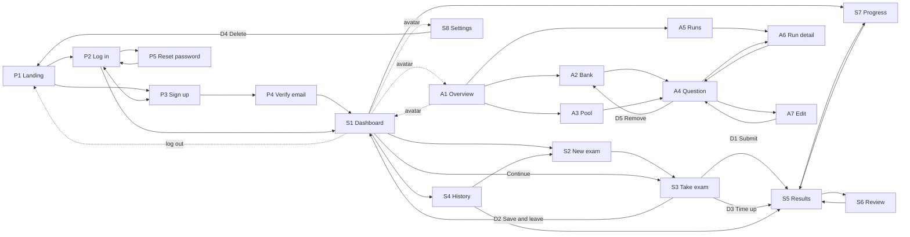

# Prototype Plan: Screens Only

Status: planning. No code yet.

Goal: build every screen of the web app as a clickable prototype, with no
real functionality. Every screen must be reachable by clicking from the
first screen, and every screen must link out to at least one other screen.

## 1. Scope

**In:** layouts, sample data, navigation between screens, visual states
(empty, selected, timer on/off, light/dark).

**Out:** real log-in (Clerk), the database, the FastAPI server, grading,
the adaptive topic split, Turnstile, image loading from R2. Buttons that
would do these things just move to the next screen.

## 2. Features

Decided on 2026-10-31. `[x]` = in, `[ ]` = dropped. Source: **paper** =
Ch 3 says so; **you** = your request; **suggested** = added in planning.

### Account

- [x] Sign up with email and password — paper — P3
- [x] Email check with a code — paper (Clerk) — P4
- [x] Log in and log out — paper — P2, avatar menu
- [x] Reset password — paper (Clerk) — P5
- [x] Bot check at sign-up — paper (Clerk + Turnstile) — P3
- [x] Landing page for logged-out visitors — you — P1
- [x] Log in with Google — suggested (Clerk supports it) — P2, P3
- [x] Delete my account and data — suggested (Data Privacy Act; Clerk has
      this built in) — S8, D4

### Starting an exam

- [x] Choose the exam: UPCAT or PSHS NCE — paper — S2
- [x] **Two exam types:** full mock exam (all subjects) or one subject
      only — you — S2
- [x] **Question count per subject:** 10, 20, 30, 40, 50 or 60 (default
      60). Default is set in Settings and can be changed on S2 — you — S2,
      S8
- [x] **Daily question limit** instead of "5 exams per day" (see below) —
      you — S1, S2
- [x] Only questions the student has not seen before — paper — none
      (server rule)
- [x] More questions on weak topics after the first exam — paper — S2
      (note), S5
- [x] Turnstile check before the exam starts — paper — S2
- [x] Timer on by default, student can turn it off — you — S2, S3, S8
- [ ] ~~Short practice on one topic~~ — dropped

**Daily question limit.** The paper allows 5 full exams per day. A full
exam is 4 subjects × 60 = 240 questions, so the same limit is **1,200
questions per day**. Every exam uses up its question count, whatever its
type:

| Exam | Questions used | Max per day |
| --- | --- | --- |
| Full, 60 per subject | 240 | 5 |
| Full, 20 per subject | 80 | 15 |
| One subject, 60 | 60 | 20 |
| One subject, 20 | 20 | 60 |

S1 and S2 show "Questions left today: 960 of 1,200". S2 disables Start
when the exam would go over the limit.

**Weak-topic split with any count.** With N questions in a subject and k
topics, topic t gets `N/(2k) + (N/2) · w_t / Σw`, rounded to add up to N
(the paper's formula is the case N = 60). One-subject exams also count
toward a student's weak topics.

### Taking the exam

- [x] Reading passage shown beside its questions — paper — S3
- [x] Figure questions with images — paper — S3
- [x] A question that depends on the one before it comes right after it —
      paper — none (server rule)
- [x] Move between subjects and questions; grid of answered questions —
      suggested — S3
- [x] Flag a question to come back to — suggested — S3
- [x] Warning before submitting with unanswered questions — suggested — D1
- [x] Save and leave; continue later — suggested — D2, S1 ("Continue
      exam" card)
- [x] Time-up dialog when the timer ends — suggested — D3

### Results

- [x] Score, score per subject, and result per topic — paper — S5
- [x] Show weak topics and what the next exam will focus on — paper — S5,
      S1
- [x] Exam history — suggested — S4
- [x] Review answers: your answer vs the correct one — suggested — S6
- [x] Explanation for each answer — suggested — S6
- [x] Score trend chart across exams — suggested — S7, S1 (small version)
- [x] Download or print results — suggested — S5 (uses the browser's
      print, with a print-friendly layout; no extra screen)

### Admin (researcher)

- [x] Browse the question bank — paper — A2
- [x] Browse the ready pool — paper — A3
- [x] See the results of each run — paper — A5, A6
- [x] Overview counts — suggested — A1
- [x] Question detail (key, LLM 2's answer, agreed or replaced) —
      suggested — A4
- [x] Edit or remove a question — suggested — A7, D5
- [x] Student numbers (sign-ups, exams taken) — suggested — A1

### General

- [x] Works well on low-end phones (bottom tab bar) — paper — all
- [x] Light and dark mode — you — all, switch in S8 and the avatar menu
- [ ] ~~Filipino language option~~ — dropped

### Changes that reach beyond the prototype

These decisions change things outside the screens. Not done yet:

1. **Ch 3, Web Application** still says "five exams per day" and "60
   questions" per subject. It needs the question limit, the two exam
   types, and the general formula above.
2. **Explanations:** bank questions have one. Generated questions only
   have one if LLM 1's prompt asks for it, so the pipeline prompt and
   output schema need an `explanation` field.

## Changes after the plan (2026-10-31)

- **Palette:** the owner rejected purple and chose **"Pisara"** (chalkboard
  green `#1F8A5B`, rail `#16352B`, chalk yellow `#F2D06B`). The reference JSX
  still sets layout, shapes and motion.
- **Lenis smooth scroll** added at the owner's request (the one extra
  package; ~4 KB). Touch scrolling stays native; reduced motion turns it off.
- To stay inside the page budget, menus, dialogs and selects use the
  browser's own `popover`, `<dialog>` and `<select>` instead of bits-ui.

## 3. Tech stack (from Ch 3, Table "Tech stack")

| Part | Tool | Used in the prototype? |
| --- | --- | --- |
| Frontend | SvelteKit + TypeScript + Tailwind CSS | Yes |
| UI components | shadcn-svelte | Yes |
| Icons | `@lucide/svelte` (the reference uses `lucide-react`) | Yes |
| Theme | Light and dark through shadcn-svelte's CSS variables | Yes |
| Log-in | Clerk (`@clerk/clerk-js`) | No. Log in and sign up screens are mock forms in the same layout. Later, Clerk's sign-in form is mounted in the right half. |
| Bot check | Cloudflare Turnstile | No. A static widget box shows where it goes. |
| Backend / DB / images | FastAPI, Heroku Postgres, Cloudflare R2 | No |

Sample data: a few real questions copied from
`Paper/Question Bank/UPCAT/bank/*.json` (one per subject, one Reading
passage, one figure question), so the screens show real content.

Folder: `web-app/` in this repo (`RavenKape02/mock-exam-generator`).
FastAPI and the batch pipeline get their own folders later.

### Lightweight pages

Pages must stay as light as possible, for low-end phones on slow mobile
data (Ch 3's reason for picking Svelte).

**Budget per page, first load on a phone:**

| What | Limit |
| --- | --- |
| JavaScript (gzipped) | ≤ 100 KB ([common guideline is 300 KB](https://dev.to/apogeewatcher/the-complete-guide-to-performance-budgets-for-web-teams-289p); our pages are simple, so we aim lower) |
| CSS (gzipped) | ≤ 30 KB |
| Fonts | 1 file (Geist variable, Latin only) |
| Images above the fold | ≤ 150 KB total |
| Core Web Vitals | LCP ≤ 2.5 s, INP ≤ 200 ms, CLS ≤ 0.1 ([thresholds](https://www.mintlify.com/addyosmani/web-quality-skills/concepts/thresholds)) |

**Allowed packages** (anything else needs your OK first):

- SvelteKit, Tailwind CSS, shadcn-svelte (only the components we use are
  copied in), `tw-animate-css` (CSS only), `@lucide/svelte` (each icon
  imported on its own, so unused icons are not shipped).
- `@sveltejs/enhanced-img`: runs at build time and makes AVIF/WebP in
  several sizes with width and height set, so nothing is added to the page
  ([docs](https://svelte.dev/docs/kit/images)). It is still pre-1.0, so pin
  its version.
- **Not allowed:** chart libraries (charts are hand-made SVG, like the
  reference), animation libraries, date libraries, icon fonts, UI kits
  other than shadcn-svelte.

**Rules:**

- **Pre-render** the public pages (P1–P5) as static HTML. Each route loads
  only its own code (SvelteKit does this by default).
- **Fonts:** self-host one Geist variable `woff2`, Latin subset, preloaded,
  `font-display: swap`. No Google Fonts request.
- **Images:** AVIF/WebP, sized per screen, `loading="lazy"` below the fold,
  width and height always set (no layout jump). The log in art loads a
  small crop on phones. Figure questions load only when shown.
- **Later, for real features:** load Clerk's full UI script only on log in
  and sign up pages and its small "headless" build elsewhere
  ([Clerk docs](https://www.clerk.com/docs/components/clerk-provider)).
  Load the Turnstile script only on P3 and S2.
- **Check it:** read the gzipped size of each route from `vite build`, run
  Lighthouse in mobile mode on every screen, and run `/impeccable optimize`
  and `audit`. A screen over budget is not done.

## 4. Design

### Reference

`Paper/PremiumDashboard.jsx` (React). Copy it to `design/reference/` in
this repo before building. Rebuild its look in Svelte; do not port the
React code line by line.

What to carry over:

- **Tokens:** the `.pd` CSS variables (background `#E8E8EE`, ink `#18171D`,
  violet `#7A5AF8`, lavender, card radius 22px, shadow) become Tailwind v4
  theme values and shadcn-svelte CSS variables. The reference is light
  only, so dark-mode values are new (made with Impeccable `colorize`).
- **Font:** Geist (install it as a package instead of the Google `@import`).
- **Shell:** dark rounded icon sidebar with the sliding nav indicator and
  tooltips; 12-column card grid on the right.
- **Parts:** `Segmented` (sliding pill switcher), `Num` (counting number,
  pure CSS, see Motion), reveal-on-load (blur to sharp, staggered),
  `Bloom` (the flower graphic), bar charts, the storage ring (reuse it as
  the score ring), list rows with hover.
- **Motion rules:** spring easing for indicators, respect
  `prefers-reduced-motion`.

Changes for this app:

- Students mostly use **low-end phones** (Ch 3), so every screen is
  designed **phone first** (see Responsive below).
- The Take Exam screen has **no sidebar** (focus mode).

### Design research (2026-10-31)

**Rule:** `PremiumDashboard.jsx` sets the look for every screen (palette,
type, sidebar, cards, Bloom, motion). The research below only shapes the
*structure* of screens the reference doesn't have. Each screen group gets
a fresh round of research before it is built.

**Take exam (S3)**
- [Coursera](https://mobbin.com/screens/668297ec-2f33-4b3b-b75c-5062c721315a):
  slim top bar with the exam name and time left, and a notice that the
  exam submits itself when time ends.
- [Workable](https://mobbin.com/screens/2cff781f-f74f-45f9-9bee-caa07ce86201):
  ring timer in a side column (matches the reference's storage ring), and
  figure questions with image options A–E. Use this for Abstract Reasoning
  and figure questions.
- [Duolingo](https://mobbin.com/screens/89b6d2cd-5e93-4ed5-97d9-1346b2b39309):
  a short intro before each section (number of questions, time) before the
  clock starts. Becomes a **subject intro state** on S3.
- [Uxcel](https://mobbin.com/screens/4d14c510-066a-4939-888c-3185af87131d):
  number keys shown on each option, so the keyboard works.
- Computer-based test guides
  ([Surpass](https://help.surpass.com/?p=27620),
  [ACT](https://www.act.org/content/dam/act/unsecured/documents/ACT-International-Subject-Test-AIST-Student-Testing-System.pdf),
  [ThinkExam](https://thinkexam.com/blog/?p=5995)): a review panel showing
  seen / answered / flagged, flag as a toggle, keep Submit away from Next,
  keyboard shortcuts, auto-submit when time ends, enough contrast.

**Results and review (S5, S6)**
- [Codecademy](https://mobbin.com/screens/8137b8b9-2481-47b6-87d9-7755ed527d0f):
  score ring with correct / wrong counts on top; below, a question list on
  the left and "Your answer" vs "Correct answer" blocks on the right.
- [Uxcel](https://mobbin.com/screens/39bc6126-c7be-4b0c-93de-befbfbe12e40):
  one row per topic with a bar and a percent. Use this for topic results.
- [Babbel](https://mobbin.com/screens/2b82718a-ea68-4be0-93a1-1829bf9da6e5):
  a "Correct my mistakes (2)" button. Use "Review wrong answers (n)".
- [Coursera](https://mobbin.com/screens/56959b73-e28c-4ed8-a6f2-df91112e5a69):
  Correct / Wrong label right under each question in review.

**Progress (S7)**
- [Duolingo](https://mobbin.com/screens/6ff49359-fff4-4ea2-97f2-50097b0873ac):
  line chart across time. Use it for the score trend.
- [MasterClass](https://mobbin.com/screens/cf71bee0-143b-4b9b-9cf1-536ad1cb7956):
  list of categories with thin bars. Use it for topic accuracy.

**Landing (P1)**
- [Brilliant](https://mobbin.com/screens/f8ff59f5-d476-48ce-9082-06c843aaa39c):
  the hero shows the product working, not a stock photo.
- [SchoolAI](https://mobbin.com/screens/2f316cb2-3af1-46c5-b1ac-3bacdae1999b),
  [Preply](https://mobbin.com/screens/cedaff55-3115-4221-81c8-20a823b2597a):
  art on one side, a single clear action on the other.
- Idea: the hero holds **one real UPCAT-style question the visitor can
  answer**, then shows "Sign up for a full mock exam".

**Other reviewers in the Philippines**
([DOST PSHS reviewer](https://www.dost.gov.ph/knowledge-resources/news/33-2013-news/118-dost-s-free-online-reviewer-for-scholarship-exam-is-now-up),
[UPCAT Champion](https://www.quia.com/pages/uplae/temporary),
[Supertutor list](https://supertutor.ph/blog/best-upcat-reviewers-2026/)):
mostly older quiz pages and PDFs. None adapts to weak topics or looks
modern, so that is where this app stands out.

**One distinctive element (frontend-design skill):** the question grid on
S3 looks like a shaded **answer sheet**, with bubbles that fill in as the
student answers. Every UPCAT and PSHS taker knows this sheet. It sits in
the reference's palette and only appears where it means something (S3,
S6).

### Motion: smooth and fast

Keep the reference's motion style (springy indicators, blur-to-sharp
reveal, counting numbers, growing bars) but make it **faster and cheaper**,
because most students are on low-end phones.

**Speed tokens** (set once in Tailwind's `@theme`; values follow
[Reshaped](https://reshaped.so/docs/tokens/animation) and
[Atlassian](https://atlassian.design/foundations/motion): small changes
fast, bigger movement a bit longer):

| Token | Time | Used for |
| --- | --- | --- |
| `--dur-instant` | 100ms | Press feedback, option select, bubble fill |
| `--dur-fast` | 160ms | Hover, tooltips, switch toggles, question change |
| `--dur-base` | 220ms | Dialogs, menus, page change |
| `--dur-slow` | 380ms | Sliding indicators (nav, Segmented), score ring, bars |
| `--dur-count` | 600ms | Number count-up |

Easing: `cubic-bezier(.2,0,0,1)` for movement on screen, an ease-out for
things entering, an ease-in for things leaving, and the reference's spring
`cubic-bezier(.34,1.45,.64,1)` **only** for indicators and press.

**Changes from the reference** (it runs 0.8s reveals and 0.55s indicators):

- Reveal on load: 0.8s → **0.36s**, blur 16px → **6px max**, stagger 70ms
  → **40ms**, and only the first ~6 items stagger. Large blurs are costly
  on phones ([case study](https://besthub.dev/articles/why-one-css-property-slowed-down-ios-and-how-a-single-line-fixed-it-20c33877cc48),
  [checklist](https://frontendchecklist.io/rules/css/animation-performance)).
- Animate **only `transform` and `opacity`** (and small blurs), never
  width, height, top or left. Bars grow with `scaleY`/`scaleX`, as the
  reference already does.
- The Bloom's endless spin stops when it is off screen or on phones.

**Where motion goes:**

| Moment | Motion |
| --- | --- |
| Page change | Cross-fade with the browser's View Transitions API through SvelteKit's `onNavigate` ([Svelte blog](https://svelte.dev/blog/view-transitions)). Browsers without it just change page |
| Sidebar / tab bar | Sliding indicator (spring, 380ms) |
| Take exam: pick an answer | Bubble on the answer sheet fills in (100ms) |
| Take exam: next / previous | Question slides 12px in the direction of travel and fades (160ms) |
| Take exam: timer | Ring drains smoothly; last minute turns warning colour (no pulsing, it distracts) |
| Results | Score ring fills and the score counts up, then topic bars grow, one after the other. This is the one "big moment" in the app |
| Dialogs and menus | Scale 0.96 → 1 with fade (220ms) |
| Switches (timer, theme) | Thumb slides (160ms); theme change cross-fades |

**Tailwind only, no motion library** (no Motion, GSAP, or Svelte
`transition:` / `Tween` / `Spring`):

- **Speed tokens and keyframes** live in Tailwind v4's `@theme` as
  `--animate-*` and `@keyframes` (reveal, bubble fill, slide, ring fill,
  bar grow), used as `animate-reveal`, `animate-fill`, etc.
- **Hover, press, toggles, indicators:** Tailwind `transition-*`,
  `duration-*`, `ease-*` utilities, with the tokens above as custom values.
- **Dialogs, menus, tooltips (enter and exit):** `tw-animate-css`, which
  shadcn-svelte already installs for Tailwind v4 ([docs](https://shadcn-svelte.com/docs/migration/tailwind-v4)).
  It is plain CSS: `animate-in fade-in zoom-in-95` /
  `animate-out fade-out zoom-out-95` on the open and closed states.
- **Number count-up:** pure CSS. An integer `@property --num` animated by
  a keyframe and shown with `counter()` ([guide](https://camoa.github.io/dev-guides/css/css-craft/css-counters-progress/),
  [Tailwind example](https://cruip.com/how-to-make-an-animated-number-counter-with-tailwind-css/)).
  Browsers without it just show the final number. The real number sits in
  hidden text for screen readers.
- **Page change:** the browser's View Transitions API, styled with CSS.
  The only script is the few lines in SvelteKit's `onNavigate` that start
  it.
- **Stagger:** a `--i` index on each item and
  `animation-delay: calc(var(--i) * 40ms)`, as the reference does.
- **Reduced motion:** Tailwind's `motion-reduce:` and `motion-safe:`
  variants.

**Rules:** motion answers what the student did or shows what changed; no
looping decoration except the Bloom; every animation turns off under
`prefers-reduced-motion`. `/impeccable animate` reviews the motion of each
screen group, and `/impeccable audit` checks performance at the end.

### Responsive: every screen, phone to desktop

**Who uses what** ([StatCounter, Philippines, June 2026](https://gs.statcounter.com/screen-resolution-stats/mobile/philippines)):
the most common phone screen is **360×800** (17.5%), then 360×806 and
414×896. The most common desktop is 1920×1080. So each screen is designed
at **360px wide first**, then widened.

**Devices every screen must work on** (CSS viewport sizes from
[screensizechecker iPhone](https://screensizechecker.com/devices/iphone-viewport-sizes),
[iPad](https://screensizechecker.com/devices/ipad-viewport-sizes),
[YesViz](https://yesviz.com/viewport.php), and
[BrowserStack](https://www.browserstack.com/guide/common-screen-resolutions);
community tables, so confirm in browser dev tools):

| Group | Devices | Viewport (W × H) |
| --- | --- | --- |
| Android phones | Most common in PH; small/old phones | 360 × 800; 320 wide (must still work) |
| iPhone | 13 mini | 375 × 812 |
| | 13–16, 16e | 390 × 844 |
| | 15 Pro, 16 Pro | 393 × 852 |
| | 17, 17 Pro | 402 × 874 |
| | Air | 420 × 912 |
| | 14–16 Pro Max | 430 × 932 |
| | 17 Pro Max | 440 × 956 |
| Phones sideways | Any of the above | e.g. 844 × 390 |
| iPad (upright) | mini | 744 × 1133 |
| | iPad, Air 11" | 820 × 1180 |
| | Pro 11" | 834 × 1210 |
| | Air 13" / Pro 13" | 1024 × 1366 / 1032 × 1376 |
| iPad (sideways) | iPad, Air 11" → Pro 13" | 1180 × 820 → 1376 × 1032 |
| iPad split screen | Half or a third of the screen | ~320–700 wide (uses the phone or tablet layout) |
| Laptops | Common Windows laptops | 1366 × 768, 1536 × 864 |
| | MacBook (older default) | 1440 × 900 |
| Desktop | Full HD monitor | 1920 × 1080 (content stops at ~1440 and centres) |

Short laptop screens (768px tall) matter as much as width: the Take exam
screen must fit the question, options and Next button without scrolling
the page at 1366 × 768.

**Breakpoints:** Tailwind's defaults (`sm` 640, `md` 768, `lg` 1024, `xl`
1280). Cards also use Tailwind v4's built-in **container queries**
(`@container`), so a card lays itself out by its own width, not the
screen's, and looks right in any grid column.

**App shell by size:**

| Width | Navigation | Content |
| --- | --- | --- |
| < 768 | Bottom tab bar (icons + short labels) | One column |
| 768–1023 | Icon sidebar | 2-column card grid |
| ≥ 1024 | Icon sidebar, as in the reference | Reference's 12-column grid |

**Screens that change most on phones:**

| Screen | Desktop / tablet | Phone |
| --- | --- | --- |
| P2, P3 Log in / Sign up | Art left, form right (50/50; 40/60 on tablet) | Short art band on top, form below |
| S3 Take exam | Passage left, question right, answer sheet in a side column | Passage / Question switch (Segmented); answer sheet opens from a "23 / 60" button at the bottom; Prev / Next fixed at the bottom within thumb reach; compact timer in the top bar |
| S4, A2, A3, A5 lists | Tables | Each row becomes a small stacked card |
| S5, S7 charts | Full labels | Same SVG, scaled; fewer axis labels |
| Dialogs and menus | Centred | Slide up from the bottom (a shadcn-svelte Dialog styled with CSS, so no extra drawer package) |

**Rules:**

- **Tap targets** at least 44×44px; answer options at least 48px tall
  ([WCAG 2.5.8 is 24px minimum; Apple 44pt; Material 48dp](https://alphagov.github.io/wcag-primer/sc/2.5.8.html)).
- Inputs use **16px text or larger**, so iPhones don't zoom in on focus.
- Use `dvh` heights and **safe-area insets**, so the bottom tab bar and
  exam buttons clear the phone's home bar and notch.
- **No sideways scrolling** at 320px on any screen.
- Hover effects are extras only; everything also works by tap and
  keyboard.
- Body text lines stay under ~70 characters on wide screens.

**Check it:** Playwright screenshots of every screen and dialog, in light
and dark mode, at these 8 sizes: **320 × 568, 360 × 800, 402 × 874
(iPhone 17), 844 × 390 (phone sideways), 820 × 1180 (iPad), 1180 × 820
(iPad sideways), 1366 × 768 (laptop), 1920 × 1080**. Plus `/impeccable
adapt` for each screen group. Before calling it done, open it once on a
real Android phone and a real iPhone.

### How the design skills are used

Impeccable leads the design work; the others back it up.

| When | Skill and command | Why |
| --- | --- | --- |
| Once, before any screen | `/impeccable init`, then `/impeccable extract` on the reference | Saves the app's design context and pulls tokens and parts from the reference |
| Before each screen group | `/impeccable shape` | Plans the layout and hierarchy before code |
| While building | frontend-design, shadcn-svelte, Svelte plugin | Visual direction, correct components, correct Svelte 5 |
| After each screen group | `/impeccable critique`, then `layout`, `typeset`, `colorize`, `animate` as needed | Scored review and fixes |
| Dark mode | `/impeccable colorize` | Builds the dark palette from the light one |
| Phones | `/impeccable adapt` | Checks the bottom tab bar and small screens |
| Before calling it done | `/impeccable audit`, `harden`, `polish` | Accessibility, edge states, final pass |

### Graphic assets

Needed:

| Asset | Where | Kind |
| --- | --- | --- |
| Large art panel | P2, P3 left half | Raster illustration |
| Hero art | P1 | Raster illustration or 3D render |
| Empty states (no exams yet, no history, no results) | S1, S4, S7 | Small illustrations |
| Score celebration | S5 | Small illustration |
| Logo and favicon | All | Vector (SVG) |

The Bloom graphic, charts, rings, and backgrounds are code (CSS or SVG),
so they need no outside tool.

**Raster art: OpenAI Images API**, using the key already in
`Paper/codebase/.env` (checked 2026-10-31; it can use `gpt-image-2.5-flare`
and `gpt-image-2.5-sunburst`).

- Made in build step 4, after `/impeccable init`, so the prompts use the
  final palette (lavender, violet, ink) and the soft 3D look of the Bloom.
- Try one asset on both models first and keep the better one.
- A small script in `design/assets/generate.py` holds every prompt, so any
  asset can be made again. It reads the key from `.env`, never prints it,
  and passes `base_url` explicitly (your Windows env has a stale
  `OPENAI_BASE_URL`).
- Output: WebP in `web-app/static/images/`, with a light and a dark
  version where the art has a background.
- The logo is vector, so it is drawn in SVG by hand, not generated.

## 5. Screens

20 screens and 5 dialogs.

### Public (logged out)

| ID | Screen | Route | What it shows | Goes to |
| --- | --- | --- | --- | --- |
| P1 | Landing | `/` | What the app is (free UPCAT and PSHS NCE mock exams, more questions on weak topics), 3-step "how it works", hero art | Log in → P2, Sign up → P3 |
| P2 | Log in | `/login` | **Split screen.** Left: art panel with a one-line caption. Right: Continue with Google, email, password, "Forgot password?", Log in | Log in or Google → S1, Forgot password → P5, Sign up → P3, Logo → P1 |
| P3 | Sign up | `/signup` | Same split layout. Continue with Google, email, password, Turnstile box, Create account | Create account → P4, Google → S1, Log in → P2, Logo → P1 |
| P4 | Verify email | `/verify-email` | 6-digit code input, Resend code | Verify → S1, Back → P3 |
| P5 | Reset password | `/forgot-password` | Email field, Send reset code; then a "check your email" state | Back to log in → P2 |

Split-screen log in references (art on one side, form on the other):
[Runway](https://mobbin.com/screens/0a00aea9-3961-4ce3-b84e-aff695bf16e2),
[Deputy](https://mobbin.com/screens/ec13b51b-11a7-455f-b780-98766c2606e0),
[Recraft](https://mobbin.com/screens/78fc1f7b-1a0d-4815-abf0-36b04e2aa43b)
(also shows an inline Turnstile box),
[Lovable](https://mobbin.com/screens/23a8697b-220b-4ed1-90c8-94b2bbcbef67).
On phones, the art shrinks to a short band above the form.

### Student (app shell: Dashboard, New exam, History, Progress; avatar menu at the bottom)

| ID | Screen | Route | What it shows | Goes to |
| --- | --- | --- | --- | --- |
| S1 | Dashboard | `/app` | "Continue exam" card (when one is saved), hero "Start a mock exam", last score, weak topics, small score trend, recent exams, questions left today | Continue → S3, Start → S2, Last score → S5, Recent exam → S5, Trend → S7, See all → S4 |
| S2 | New exam | `/app/exams/new` | Exam (UPCAT / PSHS NCE), type (Full / One subject + subject picker), question count per subject (10–60), "this uses 80 of your 960 questions left today", topic split note, timer switch, Turnstile box. State: over the limit | Start → S3, Cancel → S1 |
| S3 | Take exam | `/app/exams/[id]` | Focus layout. **Subject intro state** first (questions, time, Start). Header: exam name, subject tabs, ring timer with an on/off switch. Question card (stem, figure, options with number keys), passage panel for Reading, answer-sheet grid (answered / flagged), Prev / Next / Flag, Submit kept apart from Next | Submit → D1, Save and leave → D2, Timer ends → D3 |
| S4 | History | `/app/exams` | Past exams: date, exam, type, count, score, score per subject. Filter: All / Full / One subject. Empty state | Row → S5, New exam → S2 |
| S5 | Results | `/app/exams/[id]/results` | Score ring, score per subject, result per topic with weak topics marked, "Your next exam will focus on …", Print | Review answers → S6, Progress → S7, New exam → S2, Dashboard → S1 |
| S6 | Answer review | `/app/exams/[id]/review` | Filter (All / Wrong / Unanswered), subject tabs, each question with your answer, the correct answer, explanation, passage | Back to results → S5 |
| S7 | Progress | `/app/progress` | Score trend across exams (per subject), topic accuracy over time, weakest topics. Empty state | Exam point on chart → S5, Start → S2 |
| S8 | Settings | `/app/settings` | Email (read-only), default question count, timer on by default, light / dark, Delete account | Delete → D4, Back → S1 |

| ID | Dialog | Opens on | Content | Goes to |
| --- | --- | --- | --- | --- |
| D1 | Submit | S3 | "You have 12 unanswered questions" | Submit → S5, Keep going → S3 |
| D2 | Save and leave | S3 | "Your answers and time left are saved" | Leave → S1, Stay → S3 |
| D3 | Time's up | S3 | "Time's up. Your answers were submitted." | See results → S5 |
| D4 | Delete account | S8 | Type DELETE to confirm; all exams and scores are removed | Delete → P1, Cancel → S8 |

**Avatar menu** (student and admin shells): email, light / dark switch,
Settings → S8, "Switch to admin view" or "Switch to student view"
(prototype only, so admin screens are reachable), Log out → P1.

### Admin (researcher; app shell: Overview, Question bank, Ready pool, Runs)

| ID | Screen | Route | What it shows | Goes to |
| --- | --- | --- | --- | --- |
| A1 | Overview | `/admin` | Bank per exam and subject, ready pool left per subject, runs done (x of 100), students (sign-ups, exams taken this week) | Bank → A2, Pool → A3, Runs → A5 |
| A2 | Question bank | `/admin/bank` | Filters (exam, subject, topic), search, rows (ID, topic, stem preview, figure icon) | Row → A4 |
| A3 | Ready pool | `/admin/pool` | Same filters plus kind (new / variant), rows | Row → A4 |
| A4 | Question detail | `/admin/questions/[id]` | Stem, passage, figure, options, key, explanation. For generated items: kind, LLM 2's answer, agreed or replaced, run | Edit → A7, Remove → D5, Run → A6, Back → A2 or A3 |
| A5 | Runs | `/admin/runs` | List of runs: exam, date, items generated, disagreements, bank fallbacks | Row → A6 |
| A6 | Run detail | `/admin/runs/[id]` | Per subject and topic: generated, agreed, replaced by a bank question; list of disagreements | Disagreement → A4, Back → A5 |
| A7 | Edit question | `/admin/questions/[id]/edit` | Form: topic, stem, figure, options, key, explanation | Save or Cancel → A4 |

| ID | Dialog | Opens on | Content | Goes to |
| --- | --- | --- | --- | --- |
| D5 | Remove question | A4 | "Students will no longer get this question" | Remove → A2 or A3, Cancel → A4 |

### Screen map

**Reachability check:** every screen and dialog above has at least one way
in and one way out. Sidebar links add more paths. When the prototype is
built, Claude clicks through all screens and dialogs with Playwright, in
light and dark mode, to confirm none is cut off.

## 6. Claude skills

Install the "now" group before building. Third-party skills are
instructions (and sometimes scripts) that Claude follows, so read each
`SKILL.md` before installing.

Install at **project scope** where possible, so the setup is saved in this
repo's `.claude/` and travels with it.

### Now: for the prototype

| Skill | From | What it gives | Install |
| --- | --- | --- | --- |
| **Impeccable** | pbakaus/impeccable (~96.6k stars) | Design skill with 24 commands: `critique`, `audit`, `polish`, `layout`, `typeset`, `colorize`, `animate`, `adapt` (mobile), `harden`, and more | `/plugin marketplace add pbakaus/impeccable` then install it from `/plugin`. Or run `npx impeccable install` in the repo root, then `/impeccable init` |
| **Svelte plugin** | sveltejs/ai-tools (official) | Svelte MCP server (docs lookup, autofixer), skills `svelte-code-writer` and `svelte-core-bestpractices`, and a Svelte subagent | `/plugin marketplace add sveltejs/ai-tools` then `/plugin install svelte`. Project-scope option: `npx sv add ai-tools="ide:claude-code+delivery:plugin"` |
| **shadcn-svelte** | huntabyte/shadcn-svelte (official) | Components, theming with CSS variables, dark mode, Tailwind v4 setup | `npx -y skills add huntabyte/shadcn-svelte --skill shadcn-svelte --agent claude-code` |
| frontend-design | Anthropic | Visual direction, avoids template look | Already installed |
| Playwright | Anthropic plugin | Clicks through screens and takes screenshots to check reachability | Already installed |
| web-design-guidelines *(optional)* | vercel-labs/agent-skills | Audit against 100+ accessibility and UX rules. Overlaps with Impeccable's `audit` | `npx skills add vercel-labs/agent-skills --skill web-design-guidelines` |

### Later: when we add real functionality

| Skill | From | What it gives | Install |
| --- | --- | --- | --- |
| Clerk | clerk/skills (official) | `clerk-setup`, `clerk-custom-ui`, `clerk-backend-api`, `clerk-testing`. No Svelte or Python skill yet, so session-token checks in FastAPI follow Clerk's docs | `/plugin marketplace add clerk/skills` then `/plugin install clerk@clerk-skills` |
| Cloudflare | cloudflare/skills (official, ~3.2k stars) | `turnstile-spin` (Turnstile end to end), `wrangler` (covers R2) | `/plugin marketplace add cloudflare/skills` then `/plugin install cloudflare@cloudflare` |
| Postgres best practices | Supabase | Schema, migrations, indexes; works for any Postgres, including Heroku Postgres | Already installed |
| FastAPI *(check first)* | jezweb/claude-skills (community) | FastAPI with Pydantic v2 patterns. There is no official FastAPI skill | `npx -y skills add jezweb/claude-skills --skill fastapi --agent claude-code` |

Not added: a separate Tailwind skill (the shadcn-svelte skill covers
Tailwind v4) and a Heroku skill (none worth it found).

## 7. Build order (after this plan is approved)

1. Install the "now" skills.
2. Create the SvelteKit app in `web-app/`, add Tailwind and shadcn-svelte.
3. Run `/impeccable init` and `extract` on the reference; set the light
   and dark themes.
4. Make the graphic assets (section 4).
5. Build the shared parts: app shell (sidebar and bottom tab bar), card,
   Segmented, Num, Bloom, score ring, bar and line charts.
6. Build screens group by group (P, S, A). For each group: research
   online first (Mobbin and the web), then `/impeccable shape`, build,
   then `/impeccable critique`.
7. Click through every screen and dialog with Playwright in both themes
   and at the 8 check sizes (section 4, Responsive), then run
   `/impeccable adapt`, `audit` and `polish`.
8. Check every screen against the page budget (section 3) with `vite
   build` sizes, Lighthouse mobile, and `/impeccable optimize`.

## Sources

- Impeccable: https://github.com/pbakaus/impeccable
- Svelte AI skills: https://svelte.dev/docs/ai/skills and https://svelte.dev/docs/ai/claude-plugin
- shadcn-svelte skill: https://shadcn-svelte.com/docs/skills
- Clerk skills: https://github.com/clerk/skills
- Cloudflare skills: https://github.com/cloudflare/skills
- Vercel web-design-guidelines: https://vercel.com/kb/guide/agent-skills-creating-installing-and-sharing-reusable-agent-context
- FastAPI community skill: https://agent-skills.md/skills/jezweb/claude-skills/fastapi
